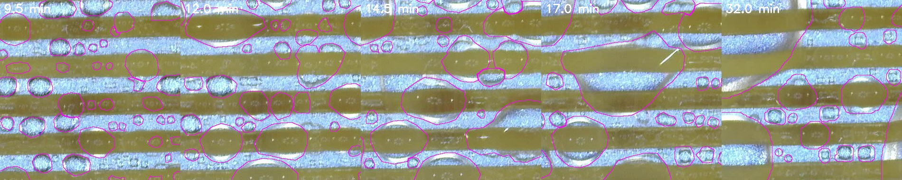
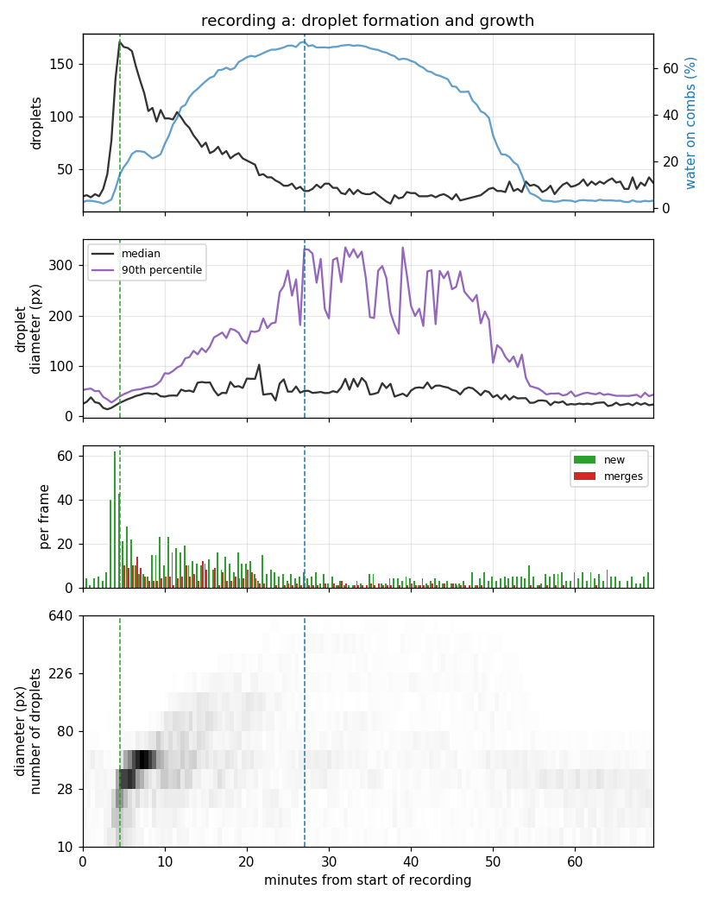
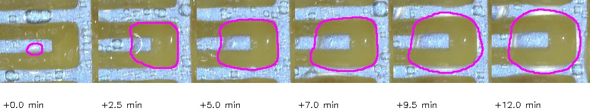

# pcb-condensation

Segmentation and tracking of condensation droplets on PCB comb structures
in climate chamber videos. Finds the water on every frame, splits it into
single droplets, measures them, and follows them through a recording: when
they appear, how fast they grow, and when they start to merge into larger
droplets.

Built from my internship work at Bosch (Automotive Electronics,
Schwieberdingen) in 2021/22, rewritten from scratch with the original
recordings and my labels. Background, and what was wrong with the 2022
evaluation: [docs/background.md](docs/background.md).



## What is in here

| Part | Where |
|---|---|
| Dataset from the raw frames and Labelme / Apeer labels | `scripts/build_dataset.py`, [data/README.md](data/README.md) |
| Pixel forest baseline (26 hand made features) | `dropseg.baseline` |
| Plain U-Net and U-Net with ImageNet ResNet-18 encoder | `dropseg.models.unet`, `dropseg.train` |
| Mask R-CNN for single droplets (COCO start, small anchors) | `dropseg.models.maskrcnn` |
| Watershed split of a water mask into droplets, droplet statistics | `dropseg.droplets` |
| Comb structure found on the driest frame | `dropseg.electrodes` |
| Droplet tracking: new, grown, merged, vanished | `dropseg.tracking` |
| Time series and events of a recording | `dropseg.monitor` |
| Time-block cross-validation, the 2022 protocol repeated, Optuna | `scripts/` |
| Command line tool | `dropseg predict`, `dropseg watch` |

How it works: [docs/method.md](docs/method.md). All results:
[docs/results.md](docs/results.md).

## Results in short

Water / dry on held-out frames of recording a (time-block cross-validation,
neighbouring frames kept out of training):

| | pixel forest | plain U-Net | ResNet-18 U-Net |
|---|---|---|---|
| pooled Dice | 0.73 | 0.80 | **0.85** |
| mean Dice per frame | 0.70 | 0.77 | **0.82** |

The 2022 figure of Dice 0.90 came from augmented copies of the same 10
frames on both sides of a random split. Repeating that protocol gives 0.88
on its own validation crops and 0.61 on unseen frames of the same recording.

Single droplets on the five fully outlined frames (588 droplets, IoU >= 0.5):

| | precision | recall | F1 |
|---|---|---|---|
| ResNet-18 U-Net + watershed | 0.16 | 0.13 | 0.14 |
| **Mask R-CNN** | **0.62** | **0.68** | **0.65** |

Droplets from about 20 px across (two thirds of a comb finger) are found
three times out of four by Mask R-CNN.

How condensation develops, from the hand labels of recording a: between
9.5 and 32 min the number of droplets falls from 177 to 57 while the wet
area grows from 21 % to 62 % and the 90th percentile diameter from 66 to
264 px. Growth is dominated by merging.

In the ten recordings (U-Net + watershed, tracked frame by frame) the same
sequence shows up wherever a stage was recorded. In recording a, which
starts on a dry board: about 140 droplets appear between 2.5 and 4.5 min,
the first frame clearly above the dry level comes at 3 min, 24 min before
the wettest point. Then, over 22 min, the number of droplets falls from 165
to 31 while the wet area rises to 70 % and the 90th percentile diameter
from 40 to over 300 px; one droplet swallows 55 others. Mask R-CNN on the
same recording gives the same timing. Recordings b to e start inside the
merge phase, f to j at the wettest point (drying only).





One frame takes 0.7 s on a laptop CPU (frames come every 30 s). On a dry
board the method still reports 2 to 4 % wet area in small false spots, so
single tiny droplets on a dry board are below what it can tell apart.

## Usage

```bash
pip install -e ".[dev]"

dropseg predict data/recordings/a/a030.jpg --out out/
dropseg watch data/recordings/a --out out/a
```

`predict` writes the water mask and an overlay with droplet outlines;
`watch` writes the droplet time series of a folder of frames and its events.

Experiments, in the order they were run (CPU times on a laptop):

```bash
python scripts/build_dataset.py --source <project folder> --layout <layout.json>
python scripts/plot_label_growth.py
python scripts/run_cv.py                       # about 4 h
python scripts/plot_cv.py
python scripts/run_instances.py                # Mask R-CNN, about 2 h
python scripts/run_leaky_protocol.py
python scripts/run_optuna.py                   # about 1.5 h
python scripts/train_final.py
python scripts/run_recordings.py
python scripts/train_maskrcnn_final.py
python scripts/run_recordings.py --maskrcnn models/maskrcnn_final.pt --recordings a
pytest
```

## Data

The recordings and labels are Bosch test data and are not covered by the
license of the code. See [data/README.md](data/README.md).

## Open points

- The frames have no scale bar, so sizes are in pixels. One comb finger is
  about 30 px wide; with the finger width from the board layout the
  numbers convert to micrometres directly.
- Mask R-CNN was trained on five frames, mostly with small droplets, and
  misses the large droplets and films of the late phase. More outlined
  frames from the late phase would fix that.
- The electrical measurement of the comb (leakage current or impedance)
  was not available. Putting it next to the droplet time series would show
  which droplet stage the electrical signal responds to.
- A model trained on one camera position needs a few labelled frames of a
  new position (Dice 0.15 without, 0.79 with three frames).
