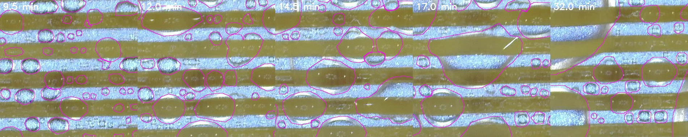
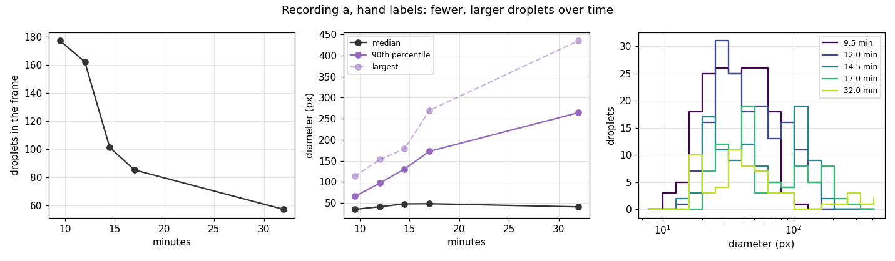
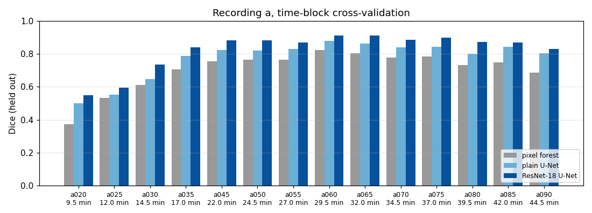
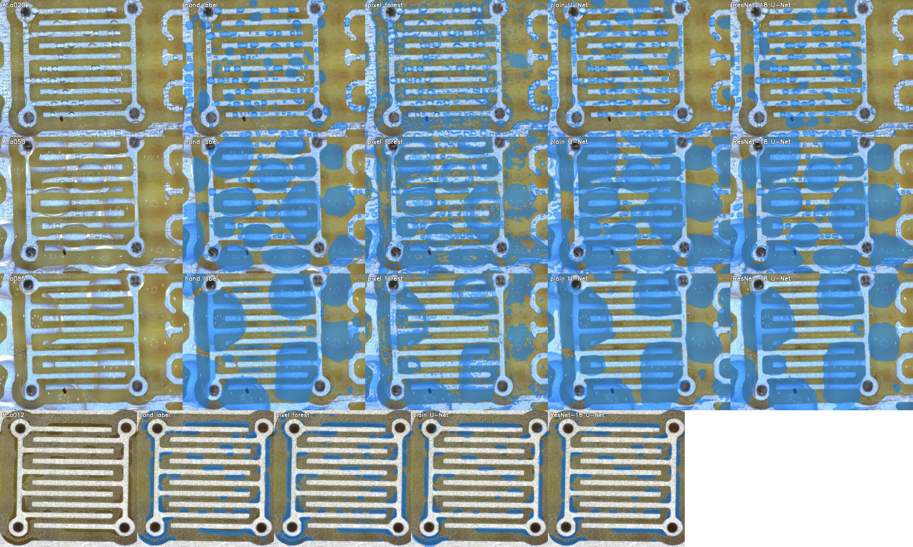
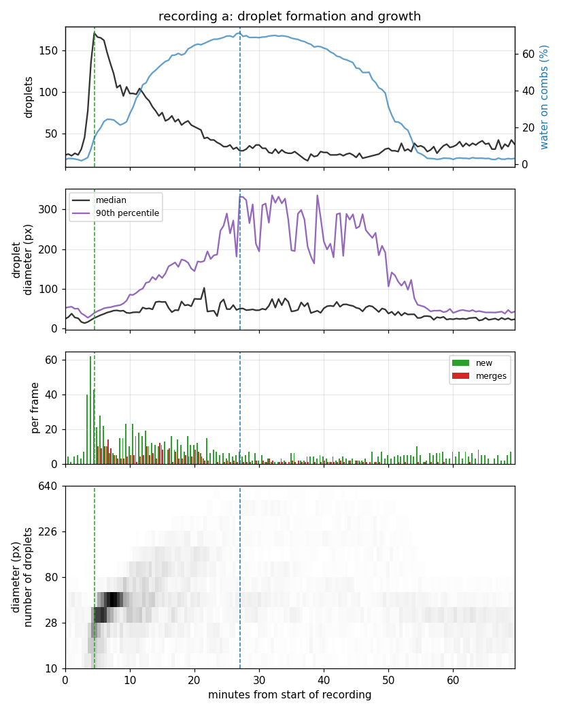
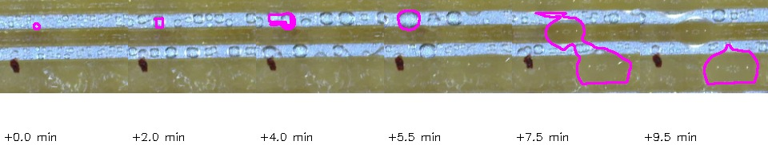
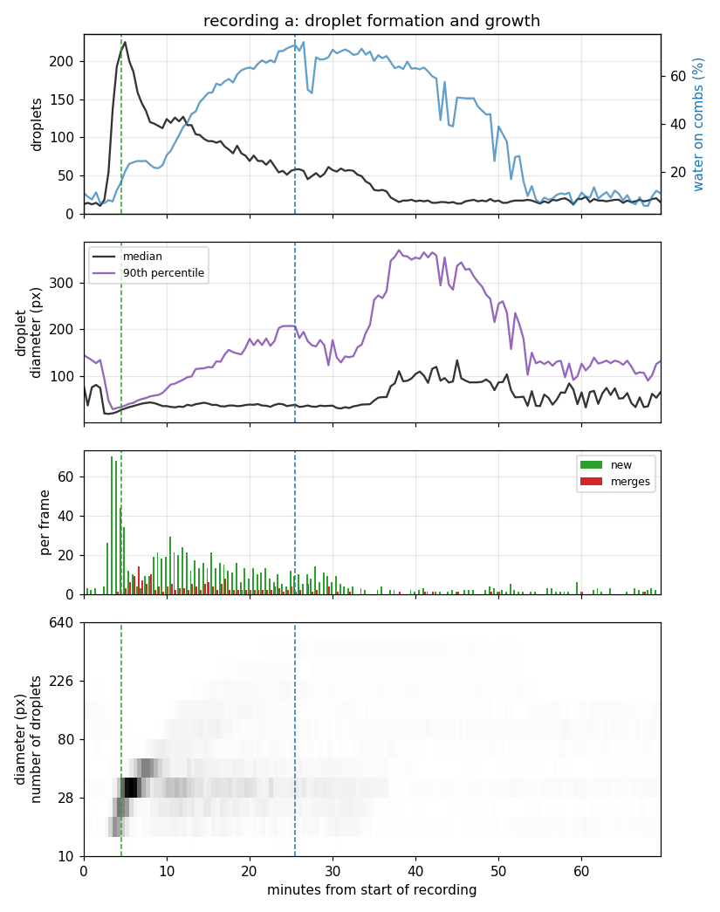
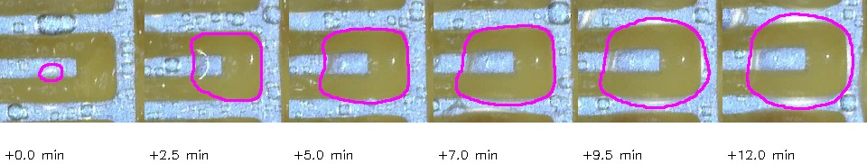

# Results

All numbers come from frames the model did not see during training. How
the frames were split is described in [method.md](method.md). Everything
ran on a laptop CPU (8 threads); there was no GPU.

## 1. Droplet growth in the hand labels

Before any model: the five frames of recording a in which I outlined every
droplet already show how condensation develops on the comb structure
(`scripts/plot_label_growth.py`, diameters in pixels of the 1280x960 frame).

| time | droplets | median diameter | 90th percentile | largest | water |
|---|---|---|---|---|---|
| 9.5 min | 177 | 35 | 66 | 113 | 21 % |
| 12.0 min | 162 | 41 | 97 | 153 | 39 % |
| 14.5 min | 101 | 48 | 131 | 179 | 42 % |
| 17.0 min | 85 | 48 | 173 | 270 | 51 % |
| 32.0 min | 57 | 41 | 264 | 435 | 62 % |

The number of droplets falls by two thirds while the wet area triples.
Small droplets do not just grow, they run into each other and merge, and
the large end of the size distribution moves out much faster than the
median (90th percentile x4, median x1.2). By 17 min single droplets span
several fingers of the comb.

*The same part of the comb at 9.5, 12, 14.5, 17 and 32 min, droplets
outlined in magenta (hand labels).*

## 2. Water / dry segmentation

### Recording a, time-block cross-validation (14 frames, 5 folds)

| method | mean Dice per frame | pooled Dice | pooled IoU | precision | recall |
|---|---|---|---|---|---|
| pixel forest | 0.70 +- 0.12 | 0.73 | 0.57 | 0.75 | 0.71 |
| plain U-Net | 0.77 +- 0.11 | 0.80 | 0.66 | 0.74 | 0.87 |
| **ResNet-18 U-Net** | **0.82 +- 0.11** | **0.85** | **0.73** | 0.85 | 0.85 |

From a35 on, the ResNet-18 U-Net is between 0.83 and 0.91 on every frame.
The first three frames are the hard ones (0.55, 0.59, 0.74): the droplets
are small, the water covers only 20 to 40 % of the frame, and these frames
were labelled with Labelme polygons while the training frames of their
fold all have Apeer brush masks, which draw droplet edges more generously.

### Other camera setup (reference measurement, 6 frames)

| method | trained on recording a only | + 3 reference frames in training |
|---|---|---|
| pixel forest | 0.24 | 0.75 |
| plain U-Net | 0.23 | 0.72 |
| ResNet-18 U-Net | 0.15 | **0.79** |

(pooled Dice.) A model trained on one camera position does not carry over
to another: the reference frames are zoomed in further, lit differently,
and the droplets are much smaller (2 to 29 % water). With three frames of
the new setup in training the score is back near the recording a level.
For a new chamber setup, a handful of labelled frames is needed.

*Held-out frames: image, hand label, pixel forest, plain U-Net, ResNet-18
U-Net. Water in blue.*

## 3. The 2022 protocol, repeated

`scripts/run_leaky_protocol.py` builds the 2022 dataset again (10 frames,
500 augmented crops, random 80/20 split) and trains the plain U-Net on it.

| scored on | Dice |
|---|---|
| the random validation crops (what was reported in 2022) | 0.88 |
| frames a20 to a35 of the same recording, never seen | 0.61 |
| the reference measurement | 0.14 |

The 2022 figure of 0.90 is reproduced, and it says little about new frames.
The validation crops are augmented copies of the training frames. The
honest number for that setup is around 0.6; with proper splits, all 20
frames and a pretrained encoder it is 0.85.

## 4. Single droplets: Mask R-CNN against U-Net + watershed

Five frames have every droplet outlined (588 droplets). Mask R-CNN was
trained in three folds over them (frames next to a test frame left out),
about 40 min per fold. The semantic models use their held-out masks from
section 2, split into droplets by the watershed. A droplet counts as found
if a predicted droplet overlaps it with IoU >= 0.5.

| method | precision | recall | F1 | count error |
|---|---|---|---|---|
| watershed on the hand masks (upper limit of the splitting step) | 0.59 | 0.58 | 0.58 | 3 % |
| **Mask R-CNN** | **0.62** | **0.68** | **0.65** | 29 % |
| ResNet-18 U-Net + watershed | 0.16 | 0.13 | 0.14 | 16 % |
| plain U-Net + watershed | 0.05 | 0.04 | 0.05 | 29 % |
| pixel forest + watershed | 0.02 | 0.13 | 0.03 | 766 % |

Per frame (F1):

| frame | droplets | Mask R-CNN | watershed on hand mask | ResNet-18 U-Net + watershed |
|---|---|---|---|---|
| a20, 9.5 min | 182 | 0.63 | 0.94 | 0.12 |
| a25, 12 min | 163 | 0.65 | 0.07 | 0.03 |
| a30, 14.5 min | 101 | 0.67 | 0.46 | 0.04 |
| a35, 17 min | 85 | 0.66 | 0.73 | 0.35 |
| a65, 32 min | 57 | 0.66 | 0.91 | 0.34 |

- Where droplets stand apart (a20, a65), cutting the hand mask at the
  narrow necks works almost perfectly. Where many droplets touch (a25,
  a30), the watershed cuts in different places than a person would, and
  even the perfect mask only reaches 0.07 to 0.46. Mask R-CNN has learned
  what a single droplet looks like and stays at 0.63 to 0.67 on every frame.
- The U-Net masks are good for the wet area (section 2) and give roughly
  the right droplet count (16 % off), but their edges are not exact enough
  for one-to-one matching of single droplets.
- Mask R-CNN misses the largest droplets and water films of the late
  frames (Dice of the wet area on a65: 0.36 against 0.91 for the U-Net):
  it was trained mostly on the small droplets of the early frames.

**Smallest droplets.** Share of the outlined droplets that are at least
half covered by the prediction, by size:

| diameter (px, full frame) | droplets | Mask R-CNN | ResNet-18 U-Net | plain U-Net |
|---|---|---|---|---|
| 10 to 20 | 46 | 48 % | 28 % | 52 % |
| 20 to 40 | 231 | 74 % | 59 % | 75 % |
| 40 to 80 | 193 | 77 % | 61 % | 61 % |
| 80 and more | 111 | 80 % | 80 % | 74 % |

Droplets from about 20 px across (two thirds of a comb finger width) are
found three times out of four; below that, about every second one. Only
one outlined droplet is smaller than 10 px, so nothing can be said below
that size.

## 5. Hyper-parameter search

Optuna, 10 trials of 400 steps on its own split (training a20 to a55,
validation a70 to a90). Validation Dice:

| trial | network | learning rate | crop | Dice |
|---|---|---|---|---|
| 0 (setting of the cross-validation) | ResNet-18 | 3.0e-4 | 192 | 0.837 |
| **1 (best)** | ResNet-18 | 7.8e-4 | 256 | **0.864** |
| 2 | ResNet-18 | 6.0e-4 | 256 | 0.862 |
| best plain U-Net (trial 4) | plain | 4.1e-4 | 256 | 0.821 |

ResNet-18 is ahead in every comparable trial; larger crops and a somewhat
higher learning rate help a little (+0.03). The final model uses trial 1.
The search ran after the cross-validation, so the numbers of section 2 are
not tuned on their own test frames.

## 6. Droplet formation and growth in the ten recordings

The final ResNet-18 U-Net, the watershed split and the tracking were run
over all 1,212 frames (`scripts/run_recordings.py`). Per recording there is
a time series (`results/recordings/<rec>.csv`), a plot, a video with
droplet outlines coloured by size, and the growth of one example droplet.

*Recording a. Top: number of droplets (black) and wet share of the comb
area (blue). Then the median and 90th percentile droplet diameter, new
droplets and merges per frame, and the size distribution over time (darker
= more droplets of that size). Green line: most droplets; blue line:
wettest frame.*

Recording a is the only one that starts on a dry board, and it shows the
whole cycle:

1. **Nucleation, 2.5 to 4.5 min.** For the first 2.5 min the count stays at
   the dry level (23 to 31 spots, see the noise floor below). Then it
   jumps: 45 at 3 min, 77 at 3.5 min, 171 at 4.5 min. About 140 droplets
   appear within two minutes, on and between the fingers, almost all 20 to
   50 px across. The first frame that stands clearly above the dry level
   (3 min) comes 24 min before the wettest point of the cycle.
2. **Growth by merging, 4.5 to 27 min.** The number of droplets falls from
   165 to 31 while the wet area rises to 70 %. The median diameter hardly
   moves (about 50 px), but the 90th percentile goes from 40 to over 300 px:
   a few droplets swallow their neighbours and grow across several fingers.
   One of them took in 55 others. 203 merges are counted in this phase.
3. **Drying, from about 35 min.** The large droplets shrink, the 90th
   percentile diameter falls back to about 50 px, and by 53.5 min less than
   a quarter of the peak wet area is left.

| recording | length | most droplets | wettest | merge phase: droplets | 90th pct. diameter | merges | dry again |
|---|---|---|---|---|---|---|---|
| a | 70 min | 165 at 4.5 min | 70 % at 27 min | 165 -> 31 | 40 -> 323 px | 203 in 22.5 min | 53.5 min |
| b | 62 min | 107 at start | 70 % at 13.5 min | 107 -> 40 | 80 -> 224 px | 98 in 13.5 min | 45.5 min |
| c | 62 min | 94 at start | 69 % at 11 min | 94 -> 33 | 115 -> 193 px | 65 in 11 min | 35.5 min |
| d | 52 min | 62 at start | 68 % at 14 min | 62 -> 38 | 155 -> 253 px | 48 in 14 min | 34 min |
| e | 62 min | 55 at start | 69 % at 11.5 min | 55 -> 33 | 191 -> 210 px | 29 in 11.5 min | 35.5 min |
| f | 53 min | 33 | 71 % at start | drying only | | | 23.5 min |
| g | 53 min | 29 | 65 % at start | drying only | | | 23.5 min |
| h | 70 min | 31 | 71 % at start | drying only | | | 24.5 min |
| i | 52 min | 26 | 64 % at start | drying only | | | 15 min |
| j | 70 min | 58 | 59 % at start | drying only | | | 19.5 min |

The recordings were cut from the chamber video at different points of the
condensation phase. b to e start after nucleation, in the merge phase, and
the later they start in it, the fewer and larger the droplets already are
(107 droplets with a 90th percentile of 80 px in b, 55 droplets of 191 px
in e). f to j start at the wettest point and only dry. Together they cover
every stage, and the same pattern shows wherever a stage is in the
recording: many small droplets first, then fewer and larger ones, and the
peak wet area always lands at 59 to 71 % of the comb.

Droplets followed for at least 3 minutes grow at a median of 4.7 px/min in
recording a, 1.4 to 2.3 px/min in b to e, and below 1 px/min in the drying
recordings (there they mostly shrink).

**Noise floor.** At the end of every recording, on a dry board, the method
still reports 2 to 4 % wet area and 25 to 37 small spots. These are false
detections (texture and marks on the solder mask between the fingers).
Changes above that level are real; single small droplets on an otherwise
dry board cannot be told apart from it with this model.

**Speed.** 0.6 to 0.9 s per frame on the laptop CPU at half size, including
the droplet split and tracking. Frames are 30 s apart, so the analysis keeps
up with the camera with a wide margin; one 70 min recording takes about
2 min.

*Recording a, U-Net + watershed: the tracked droplet that grew most (16 to
116 px in 10 min, swallowing 8 others).*

## 7. Recording a with Mask R-CNN

Section 4 showed that Mask R-CNN separates single droplets much better than
the watershed, so recording a was also run with Mask R-CNN on the full size
frames (trained on all five outlined frames, `scripts/train_maskrcnn_final.py`;
`scripts/run_recordings.py --maskrcnn`).

| | U-Net + watershed | Mask R-CNN |
|---|---|---|
| dry level before condensation (spots) | 23 to 31 | 10 to 18 |
| first frame clearly above it | 3.0 min (45) | 3.0 min (54) |
| most droplets | 165 at 4.5 min | 200 at 4.5 min |
| wettest | 70 % at 27 min | 72 % at 25.5 min |
| droplets in the merge phase | 165 -> 31 | 200 -> 56 |
| 90th percentile diameter | 40 -> 323 px | 33 -> 206 px |
| merges counted in the merge phase | 203 | 158 |
| median growth of tracked droplets | 4.7 px/min | 4.5 px/min |
| time per frame | 0.7 s (half size) | 12.8 s (full size) |

Both methods tell the same story with the same timing: the burst of new
droplets between 2.5 and 4.5 min, then a merge phase of about 22 min in
which the number of droplets falls to a quarter or less while the large
droplets grow five- to eightfold, then drying. Mask R-CNN finds more of the
small droplets (fewer dry-level spots, more droplets at the peak) and gives
a sharper start: 18 spots at 2.5 min, 54 at 3 min, 137 at 3.5 min.

Its weak point is the one seen in section 4: the large droplets of the late
phase. Between 30 and 50 min some of them are missed in single frames, so
its wet area jumps around, and on the dry board it reports 7 to 12 % wet
area, mostly from a few large false regions. For counting and following
droplets in the early and middle phase it is the better tool; for the wet
area and the late phase the U-Net is.

*Mask R-CNN: a droplet that grows from 38 to 190 px in 12 min around the
end of a comb finger, taking in 3 neighbours.*
